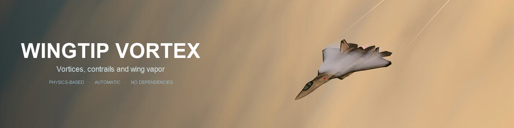

 

**[Download](https://github.com/PogKai/ksp-wingtip-vortex/releases/latest)**
&nbsp;·&nbsp; [Forum thread](https://forum.kerbalspaceprogram.com/topic/230208-ksp-vorticescontrails-mod-release/#comment-4508713)
&nbsp;·&nbsp; [Changelog](CHANGELOG.md)

 

## What it does

Install it and fly: both effects work automatically, with no per-craft setup. An optional in-flight panel lets you tune or disable them.

| | |
|---|---|
| **Wingtip vortices** | Twin vortex trails curl in behind the wingtips, stronger the harder the wing is working. On your craft and every aircraft around you, AI wingmen and BDArmory opponents included. Works on multi-part wings, canards and rockets |
| **Wing vapor** | A raymarched cloud over the wings in a hard pull, with LEX ropes and vapor over the fuselage. It is *hard to get*, on purpose |
| **Wake behaviour** | Trails spread as they age, the ground pushes them apart, and a heavily loaded core can burst |

 

## Install

1. Download the zip from the [latest release](https://github.com/PogKai/ksp-wingtip-vortex/releases/latest)
2. Copy the `WingtipVortex` folder (inside the zip's `GameData`) into your KSP `GameData/`
3. Fly

KSP 1.12.x · no dependencies · to upgrade, delete the old `WingtipVortex` folder first, then copy the new one · to remove, delete it.

Upgrading from 1.5 with the optional **Volumetric Wing Vapor** add-on? Remove that older add-on too: 2.0 includes its own volumetric renderer and no longer uses the Waterfall integration.

 

## New in 2.0.0

* **Raymarched wing vapor**: the vapor is now one soft volume over the wings, ported from [aeronautic](https://github.com/Romainlg29/aeronautic). It stands up from the skin as the pull tightens, follows the angle of attack in a cobra, draws LEX ropes off strakes and spreads over the fuselage in the hardest pulls
* **Vapor on other aircraft**: up to three aircraft near the camera get their own vapor, so formations and dogfights show it on every jet
* **Lit by the sun**, warm at sunrise and sunset; the old puffs stay available as a legacy option
* Afterburner plumes, previewed in pre-release builds, are now their own mod, [AeronauticAfterburner](https://github.com/PogKai/ksp-aeronautic-afterburner)
* Everything else in the [changelog](CHANGELOG.md)

 

## Altitude limits

Both effects are limited by air density, not height, so the limits fall at a different altitude on every body. Kerbin figures are approximate.

* **Vortices** are drawn at full strength down to the ground and in every part of the atmosphere with air density of 0.10 kg/m³ or more (roughly 15 km on Kerbin). Above that they fade out, and are gone entirely at 0.01 kg/m³ (roughly 25 km), so nothing is drawn in orbit
* **Wing vapor** only forms in the lower atmosphere: below 10% of the body's sea-level air density (about 14 km on Kerbin). Above that there is a hard cutoff, with no vapor and no cost. It also needs a real pull in humid low air
* **High-altitude contrails** need cold air, so on each body they appear only inside the band of temperatures it actually has (see the `[VORTEX] contrail band on <body>` line in `KSP.log`)

 

## Good to know

* Works with **stock aerodynamics** or **Ferram Aerospace Research** (tested with FAR 0.16.2), detected automatically
* Works alongside Scatterer, EVE, Parallax, Deferred, Singularity and Kopernicus
* **In-game settings:** in flight, click the vortex button on the app launcher (or press **Alt+V**) to switch the wingtip vortices and the wing vapor on or off, set the vortex strength and the vapor's density and height from 0 to 200%, or switch the vapor back to the legacy particle puffs. 100% is the default look. Choices are saved to `PluginData/settings.cfg` in the mod's folder

 

## Learn more

| | |
|---|---|
| [How it works](docs/how-it-works.md) | The physics behind the vortices and the wake |
| [Wing vapor](docs/wing-vapor.md) | How it forms, what to expect, and its limits |
| [Troubleshooting](docs/troubleshooting.md) | Logs, known issues, and how to report a problem |
| [Implementation reference](docs/implementation.md) | Where each effect is implemented and how the runtime pieces connect |
| [Changelog](CHANGELOG.md) | Every release |

 

## License

[CC BY-NC-SA 4.0](license.md): free to use and share, never to sell. You can:

| | |
|---|---|
| **Use it** | In your own game, videos, streams and screenshots |
| **Change it** | Fork it, modify it, fix it, build on it |
| **Share it** | Redistribute it, or bundle it in a free modpack |
| **Reuse the code** | Put any part of it in your own free mods and projects |

As long as you:

* **Credit PogKai** and link back to this repository
* **Don't sell it**, or anything built from it, or put it behind a paywall
* **Use the same license** for anything you share that's built from it

Versions up to 1.2.0 were released under MIT and stay under it. Everything after is CC BY-NC-SA 4.0.

 

## Credits

WingtipVortex's raymarched wing-vapor system is based on and ported from [aeronautic](https://github.com/Romainlg29/aeronautic) by Romain Le Gall. The upstream code is used under the MIT License; exact source revisions, copyright and license text are retained in [THIRD-PARTY-NOTICES](THIRD-PARTY-NOTICES.md), and each ported file names its upstream source.

 

## Building from source

`dotnet build WingtipVortex.csproj -c Release -p:KSPDir="<your KSP folder>"` builds `bin/Release/WingtipVortex.dll`. The platform shader bundles in `Shaders/` are included ready to use. Their source is in `Source/Shaders/` and targets Unity 2019.4.18f1 (KSP 1.12).

 

## Free, always

Every version of this mod is free. I have never charged for it and never will. If you paid for it anywhere, that money didn't go to me. Get it from the [official releases](https://github.com/PogKai/ksp-wingtip-vortex/releases) or the [forum thread](https://forum.kerbalspaceprogram.com/topic/230208-ksp-vorticescontrails-mod-release/#comment-4508713).

 

CC BY-NC-SA 4.0 · by PogKai

